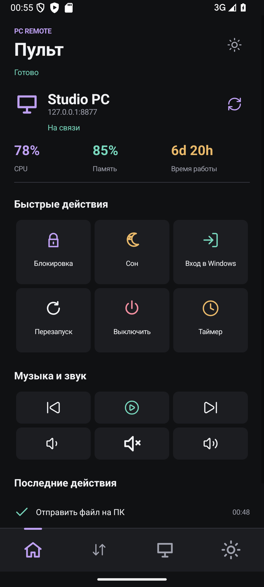
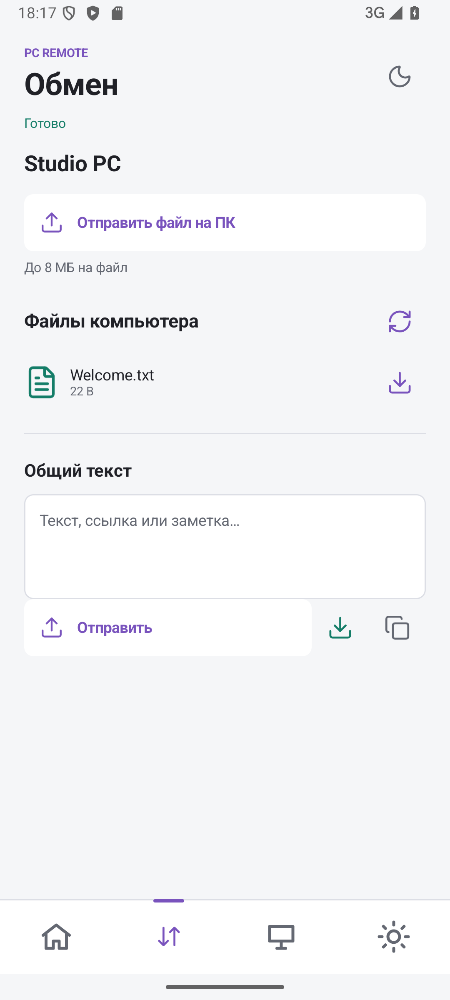

# PC Phone Remote

Turn your Android phone into a clean remote control for your own Windows PC.

PC Phone Remote connects a native Android remote to your Windows PC. Control power and media, exchange files and text, check PC health, and launch a Windows sign-in through an installed RDP client. Use it on a reachable local network or through your own HTTPS relay.

> This project is intended only for personal administration of devices you own or have permission to control.

<p>
  
  
</p>

Screenshots use a demo device profile.

## Highlights

### Version 2.1 Setup

On Windows, open `pc-phone-remote/configure.bat` for a desktop setup form. Copy the pairing code into Android's Devices / Import screen. The desktop form edits the RDP address, port, username and gateway without editing JSON; the server reloads these connection settings on the next status request.

On Android, Windows connection settings can also be edited under Settings for the selected device. Phone settings override the PC settings for that device; choose **Use PC settings** to remove the override. Windows Remote Desktop must still be enabled, and a compatible RDP client installed on the phone.

Appearance is controlled only in Settings: animated light/dark selection and Violet, Mint, Ocean, Amber and Rose palettes. The new setup form includes Russian, Ukrainian and English copy.

- Native Android app, not just a web page.
- Elegant dark UI with a light theme toggle.
- Animated theme slider and crossfade, sliding tab indicator, and tactile button animations.
- Reduced-motion preference; system animation settings are respected.
- Bottom navigation with Remote, Transfer, Devices, and Settings tabs.
- Multiple device profiles saved on the phone.
- First-run onboarding for adding the first PC.
- Pairing page with setup code and optional QR code.
- Vector icon buttons for PC commands.
- Multilingual interface:
  English, Russian, Ukrainian, Slovak, Czech, Japanese, German, Spanish, French, and Polish.
- PIN-protected command access.
- Windows autostart through Task Scheduler.
- Hidden server launch with `pythonw.exe`.
- Optional Windows tray launcher.
- Optional Task Scheduler command tasks for locked-session power actions.
- Optional relay mode for remote access outside the local network.
- Two-way file transfer through a dedicated shared folder, up to 8 MiB per file.
- Shared text board with per-device drafts and manual copy to the phone clipboard.
- CPU, memory, uptime and Windows lock state on refresh.
- Media playback, track switching and volume controls.
- Windows shutdown timer (1-180 minutes) and cancellation.
- Local per-device action history.
- Windows sign-in handoff to an Android RDP client, with optional RD Gateway.

Version 2's full copy is available in Russian and English. Other supported languages include translated primary navigation and feature labels, with English fallback for new explanations.

## Commands

The Android app can send these commands to the Windows server:

| Command | Description |
| --- | --- |
| Mute | Toggle system mute |
| Lock | Lock the Windows session |
| Sleep | Put the PC to sleep |
| Restart | Restart Windows |
| Shutdown | Shut down Windows |
| Media | Previous, play/pause, next, volume and mute; requires an unlocked session |
| Timer | Schedule Windows shutdown or cancel a pending shutdown |
| Windows sign-in | Open an installed RDP client with the PC's configured address |

## Screens And Flow

The Android app is split into four main tabs:

| Tab | Purpose |
| --- | --- |
| Remote | Send commands to the selected computer |
| Transfer | Upload, download, and exchange shared text with the selected PC |
| Devices | Add, edit, select, test, or delete PC profiles |
| Settings | Language, dark/light theme, animations, and history cleanup |

Each device profile stores:

- device name
- PC IP address or full relay URL
- port
- app PIN

No real IP address or PIN is bundled in the project. Configure your own values after installation.

## Project Structure

```text
.
|-- pc-phone-remote/
|   |-- app.py                     # Local Windows HTTP server
|   |-- relay_server.py            # Optional public relay server
|   |-- relay_agent.py             # PC-side relay polling agent
|   |-- server_tray.py             # Optional tray launcher
|   |-- requirements.txt           # Optional QR/tray dependencies
|   |-- install-deps.bat           # Dependency installer
|   |-- install-command-tasks.ps1   # Optional locked-session command tasks
|   |-- run.bat                    # Manual local server launcher
|   |-- start-hidden.vbs           # Hidden autostart launcher
|   |-- start-relay-agent.bat      # Relay agent launcher
|   |-- README.md                  # Windows server notes
|   `-- README_REMOTE.md           # Relay mode notes
|
`-- pc-phone-remote-android/
    |-- app/
    |   `-- src/main/java/com/pcphoneremote/app/MainActivity.java
    |-- gradlew.bat
    `-- README.md
```

## Requirements

### Windows PC

- Windows 10 or Windows 11
- Python 3
- Network access between phone and PC for local mode

### Android

- Android phone or emulator
- Android Studio or Gradle if building from source

### Optional Remote Relay

- Public server, VPS, or hosting platform
- HTTPS strongly recommended
- Long random relay agent token

## Quick Start: Local Wi-Fi Mode

Use this mode when the phone and PC are on the same Wi-Fi or LAN.

### 1. Start The Windows Server

```powershell
cd "pc-phone-remote"
.\install-deps.bat
$env:REMOTE_PIN = "<your-pin>"
python app.py
```

Alternatively, run without `REMOTE_PIN`: the first launch generates a random PIN in the ignored local `config.json`. View its setup code only on the PC at `http://127.0.0.1:8765/pair`. An existing config with an empty PIN must be filled in before launch.

The server prints local addresses such as:

```text
http://<your-pc-ip>:8765
```

### 2. Add The PC In The Android App

Open this page on the PC:

```text
http://127.0.0.1:8765/pair
```

Scan the QR code with the phone camera, copy the setup code, then open the Android app:

```text
Devices -> Import setup
```

You can also create a profile manually:

```text
Name:  Home PC
IP:    <your-pc-ip>
Port:  8765
PIN:   the same PIN from REMOTE_PIN
```

Tap **Save device**, select the computer, then tap the refresh icon on **Remote** to check authenticated connectivity and load PC status.

### 3. Use The Remote

Go to the **Remote** tab and send commands to the selected device.

## Build The Android App

From PowerShell:

```powershell
cd "pc-phone-remote-android"
.\gradlew.bat assembleDebug
```

The debug APK will be created here:

```text
pc-phone-remote-android/app/build/outputs/apk/debug/app-debug.apk
```

For a locally installable release-style APK:

```powershell
.\gradlew.bat assembleRelease
```

Output:

```text
pc-phone-remote-android/app/build/outputs/apk/release/app-release.apk
```

This local release uses the debug signing key for convenience. Use a real private signing key before publishing anywhere.

## Windows Autostart

The server can start automatically after Windows logon using Task Scheduler.

This project includes:

```text
pc-phone-remote/start-hidden.vbs
```

It launches the server with `pythonw.exe`, so a console window does not stay open.

Example Task Scheduler action:

```text
Program:   wscript.exe
Argument:  "C:\path\to\pc-phone-remote\start-hidden.vbs"
Start in:  C:\path\to\pc-phone-remote
```

## Windows Tray Launcher

Install optional dependencies:

```powershell
cd "pc-phone-remote"
.\install-deps.bat
```

Then run:

```powershell
pythonw .\server_tray.py
```

The tray menu opens the remote page, pairing page, shared folder, and desktop transfer page. It also restarts/stops the server or quits the tray app.

## Files And Shared Text

The server creates `shared/` beside `app.py`. Put a file in this folder on your PC, then refresh **Transfer** on your phone to download it. Uploads from Android appear in the same folder. Existing files are never overwritten by uploads; rename the file first when a name is already taken.

Each transfer is limited to **8 MiB**. Only individual files inside this folder are exposed, with filename validation and symlink checks. Downloads use Android's system save picker; no broad storage permission is required. These operations work through the v2 relay as well as directly over LAN.

The shared text board is stored as `shared/shared-note.txt` (64 KiB maximum). Edit it on either device, or use the authenticated PC page at `http://127.0.0.1:8765/share`. After first signing in on the web page, open `/share` again. Text is transferred only on request, not by monitoring either clipboard.

## Windows Sign-In

**Windows sign-in** launches an installed RDP client using Microsoft's [Android-supported RDP URI scheme](https://learn.microsoft.com/en-us/windows-server/remote/remote-desktop-services/remote-desktop-uri). Windows performs normal account authentication, including when the console is locked. It does **not** auto-type a Windows PIN or unlock the physical monitor.

1. Enable Remote Desktop on a supported Windows edition (such as Pro or Enterprise).
2. Install Windows App or another compatible RDP client on Android.
3. In the PC's local `config.json`, configure `rdp.host`, `rdp.port`, and optionally `rdp.username` and `rdp.gateway`. See `config.example.json` for the shape. Restart the PC server or agent after edits.
4. Tap **Windows sign-in** and authenticate inside the RDP client. No Windows password is stored by PC Phone Remote.

The RDP host or RD Gateway must be reachable from the phone. The project's HTTP relay transports commands and shared data, **not RDP traffic**. An RDP client, configured Windows host, and reachable network are required; the APK alone does not enable Windows remote sign-in.

The Windows shutdown timer forcibly closes programs when it expires. Save work first; use **Cancel timer** to cancel it. The timer belongs to Windows and is independent of the Android app.

## Locked-Session Power Commands

Some commands can be routed through Windows Task Scheduler so they still work while the Windows session is locked.

Install the optional tasks once:

```powershell
cd "pc-phone-remote"
powershell -ExecutionPolicy Bypass -File .\install-command-tasks.ps1
```

The local server will try to use those tasks for:

- lock
- sleep
- restart
- shutdown

For interactive access while Windows is locked, use the separate Windows sign-in/RDP flow described above. Power commands do not require an RDP session.

## Remote Access Outside The Local Network

Local mode works only when the phone can reach the PC directly. For outside-network access, the project includes an optional relay mode:

```text
Android phone -> public relay server -> PC relay agent -> Windows command
```

This avoids exposing the local Windows server directly to the public internet.

### 1. Start The Relay Server

Update **both** the relay server and PC agent to v2 before using the v2 Android app. This is a protocol upgrade. Each relay serves one PC; use separate relay deployments/URLs for separate remote PCs.

On a public server:

```powershell
cd "pc-phone-remote"
$env:RELAY_PIN = "<your-pin>"
$env:RELAY_AGENT_TOKEN = "<long-random-secret>"
python relay_server.py --host 0.0.0.0 --port 8080
```

Put HTTPS in front of the relay using your hosting provider, reverse proxy, or load balancer.

Example relay URL:

```text
https://remote.example.com
```

### 2. Start The PC Relay Agent

On the Windows PC:

```powershell
cd "pc-phone-remote"
$env:RELAY_URL = "https://remote.example.com"
$env:RELAY_AGENT_TOKEN = "<same-long-random-secret>"
python relay_agent.py
```

### 3. Add A Relay Device In Android

In the **Devices** tab, put the full relay URL into the IP/URL field:

```text
https://remote.example.com
```

When the address starts with `http://` or `https://`, the app treats it as a full server URL and ignores the port field.

## Configuration

### Local Server

| Variable | Default | Description |
| --- | --- | --- |
| `REMOTE_PIN` | empty | PIN required by the app |
| `REMOTE_HOST` | `0.0.0.0` | Bind address |
| `REMOTE_PORT` | `8765` | Local server port |

`--pin` / `REMOTE_PIN` override the local `config.json` PIN. The generated PIN is used when neither override is provided. Optional `share_dir` in `config.json` selects a different shared folder. The `rdp` object contains only connection settings, not Windows credentials.

### Relay Server

| Variable | Description |
| --- | --- |
| `RELAY_PIN` | PIN required by the Android app |
| `RELAY_AGENT_TOKEN` | Secret token used by the PC relay agent |
| `RELAY_HOST` | Relay bind address |
| `RELAY_PORT` | Relay server port |

### Relay Agent

| Variable | Description |
| --- | --- |
| `RELAY_URL` | Public relay URL |
| `RELAY_AGENT_TOKEN` | Same secret token used by the relay server |
| `RELAY_POLL_INTERVAL` | Delay after relay errors |

## Security Notes

- Use a unique PIN.
- Do not expose `app.py` directly to the public internet.
- Use relay mode with HTTPS for remote access.
- Use a long random `RELAY_AGENT_TOKEN`.
- Relay startup requires a PIN and an agent token at least 24 characters long.
- Pairing is loopback-only; it cannot be fetched from the phone or through the relay.
- Profiles and their PINs live in the Android app's private preferences. Cloud backup and device transfer of these preferences are disabled; storage is not an encrypted vault.
- Relay jobs expire after 22 seconds. Unclaimed expired commands are discarded. A lost reply after execution can leave the outcome uncertain; the app does not automatically retry commands.
- Keep relay credentials private.
- Allow Windows Firewall access only for networks you trust.
- Use this only for your own devices or systems you are allowed to control.

## Limitations

- Turning on a fully powered-off PC is not handled by this app. That requires Wake-on-LAN support and separate network setup.
- Local Wi-Fi mode requires the phone and PC to be on the same reachable network.
- Remote access requires a public relay host or equivalent deployment.
- The APK from `assembleDebug` is a debug build, not a Play Store release build.
- Windows lock-screen unlock automation is intentionally not included.
- Media keys require an unlocked interactive Windows session. Power commands and file/text exchange can work while it is locked, provided the server/agent remains running.
- Status is a snapshot from the last refresh, not continuous monitoring.
- Relay transfer data is temporarily buffered in relay memory. Use a relay you trust and HTTPS; the protocol does not add end-to-end encryption.

## Roadmap Ideas

- Signed release APK.
- Wake-on-LAN helper.
- More relay deployment examples.
- HTTPS setup guide with Caddy or Nginx.
- Chunked transfers for larger files.

## Validation

```powershell
cd pc-phone-remote
python -m unittest discover -s tests -v
cd ..\pc-phone-remote-android
.\gradlew.bat assembleDebug assembleRelease lintDebug
```

Backend tests cover authenticated HTTP access, binary and text exchange, path validation, size limits, relay round trips and expiration. Windows power operations are mocked. `tools/preview_server.py` is a loopback UI fixture that never executes system commands; `tools/android_smoke.py` exercises a dedicated Android emulator with a test profile. Screenshots and fixture files stay in ignored `artifacts/`.

## License

MIT. See [LICENSE](LICENSE).
