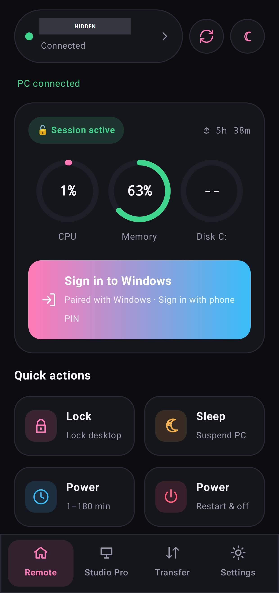
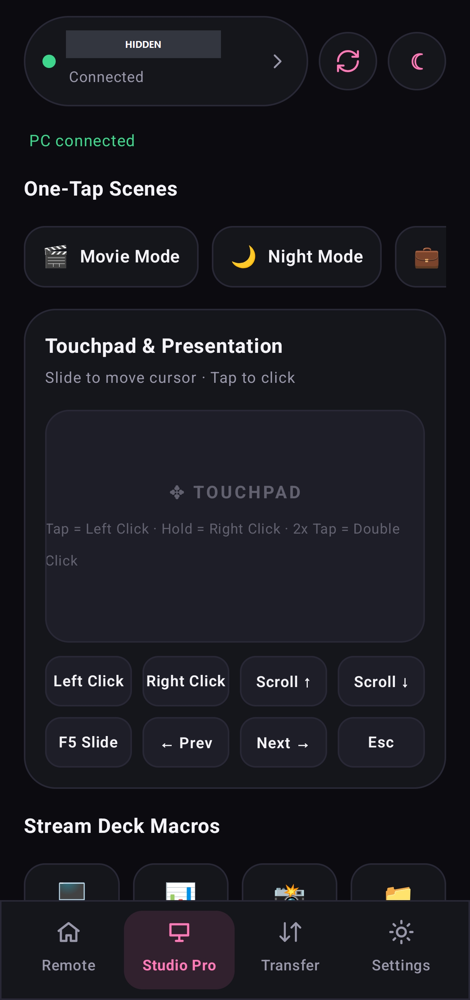
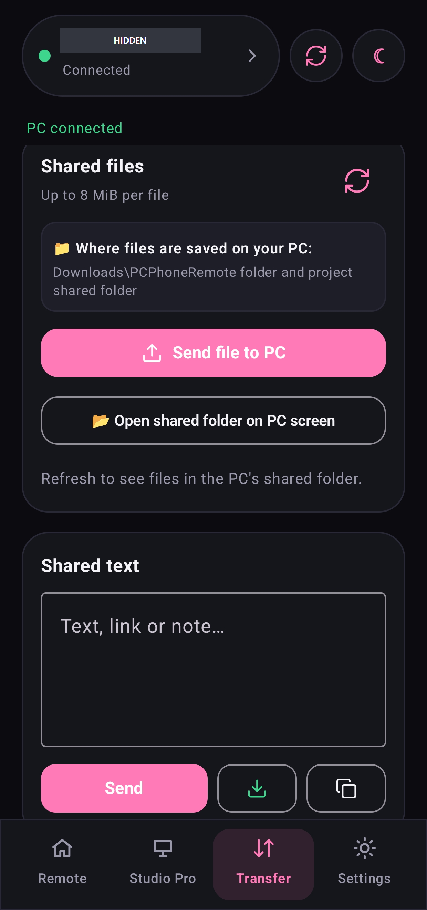
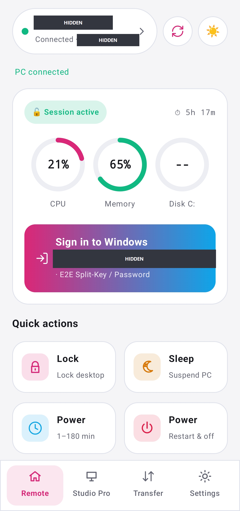
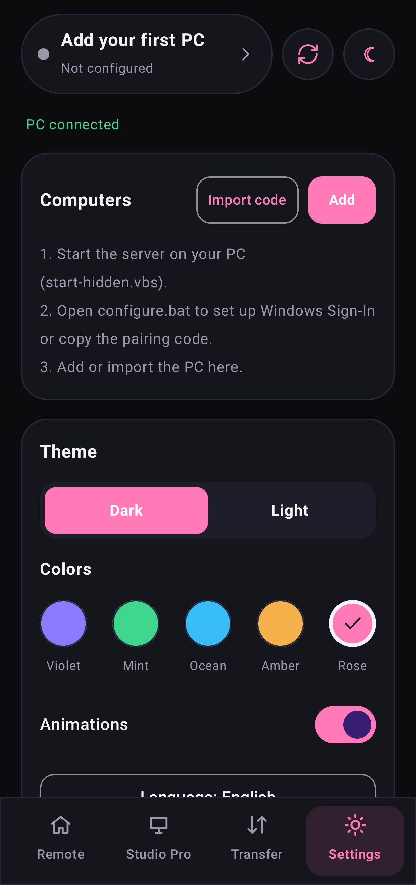
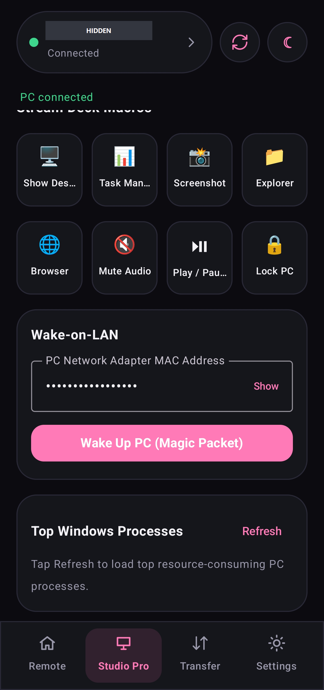

# PC Phone Remote

**Your computer, within reach of your phone.**

A personal remote for Windows and Linux: power, media, touchpad, shared files and PC status. Version **2.3.0** adds a desktop control center, QR pairing, LAN discovery, installers, an iPhone browser interface and native SwiftUI sources.

[Download 2.3.0](https://github.com/kznkutsubyo/remote-pc-control/releases/tag/v2.3.0) · [Relay package](https://github.com/kznkutsubyo/remote-pc-control/pkgs/container/remote-pc-control-relay) · [Security](SECURITY.md) · [MIT License](LICENSE)

## Preview

Real Android phone captures from an earlier 2.2 build. Personal fields have opaque masks and the phone status bar is removed. Screenshots illustrate the UI, not proof of Windows unlock.

Light theme, appearance and Wake-on-LAN

## Platform Support

| Platform | Distribution | Notes |
| --- | --- | --- |
| Android | Kotlin / Compose APK | QR scanning, LAN discovery, saved PCs and onboarding |
| Windows x64 | Setup EXE or portable ZIP | Python backend, desktop control center, optional native sign-in |
| Linux | Self-extracting .run installer | Desktop-dependent integrations; X11 and Wayland differ |
| iPhone / iPad browser | Safari at /app | Add to Home Screen; no IPA needed |
| Native iOS | SwiftUI source ZIP | Requires macOS, Xcode and your signing team |

Linux desktop behavior depends on available utilities and system policies. Native iOS is distributed as source, not a signed IPA. Windows lock-screen integration remains optional and requires separate testing in a recoverable environment.

## Features

- **Remote:** lock, sleep, restart, shutdown, playback, mute and volume.
- **Status:** CPU, memory, disk usage, uptime and session state.
- **Studio:** touchpad, presentation keys, scenes, macros and process list.
- **Wake-on-LAN:** send magic packets where hardware, firmware and network settings support them.
- **Transfer:** upload/download files up to **8 MiB**, and text up to **64 KiB**.
- **Devices:** multiple profiles, QR scanning, import codes and automatic LAN discovery.
- **Desktop setup:** connection settings, QR codes, server PIN, shared-folder and startup controls.
- **Appearance:** light/dark mode, palettes, language selection and animations.
- **Remote access:** self-hosted HTTPS relay for native clients.
- **Windows sign-in:** optional native credential provider and encrypted phone enrollment.

Use only on computers you own or are authorized to administer.

## Downloads

Get files from [Releases](https://github.com/kznkutsubyo/remote-pc-control/releases/latest):

| File | Purpose |
| --- | --- |
| PCPhoneRemote-v2.3.0.apk | Android app |
| PCPhoneRemote-Setup.exe | Windows installer and launcher |
| PCPhoneRemote-Linux-Installer.run | Linux installer |
| PCPhoneRemote-Windows-v2.3.0.zip | Portable Windows sources and native x64 sign-in binaries |
| PCPhoneRemote-Relay-v2.3.0.zip | Self-hosted relay sources |
| PCPhoneRemote-iOS-Source-v2.3.0.zip | SwiftUI sources and instructions |
| SHA256SUMS.txt | Download checksums |

The APK uses a development signing key. Windows executables are unsigned. The Windows launcher wraps Python; Python is a prerequisite, not a bundled runtime.

## Quick Start

### Windows

1. Install Python 3.10+ and run PCPhoneRemote-Setup.exe, or extract the Windows ZIP and run Install-PCPhoneRemote.bat.
2. Complete setup, choose a server PIN and allow network access only where needed.
3. Open PC Phone Remote. Its desktop control center is at http://127.0.0.1:8765/desktop.
4. Scan its Android pairing QR or import the connection code on the phone.

The control center and pairing endpoints are local-only. Native Windows sign-in is an optional installation, not a prerequisite for ordinary controls.

Manual startup:

~~~powershell
cd pc-phone-remote
python -m pip install -r requirements.txt
$env:REMOTE_PIN = "<your-own-pin>"
python app.py
~~~

Without a PIN override, first launch generates a random PIN in ignored local config.json. Changing the PIN in the desktop control center rejects old PINs and clears existing API/web sessions. Previously retained alias PINs are no longer supported.

### Linux

~~~bash
chmod +x PCPhoneRemote-Linux-Installer.run
./PCPhoneRemote-Linux-Installer.run
~~~

The installer uses a per-user directory and a Python virtual environment when available. Install desktop utilities such as playerctl, xdotool, wmctrl, pactl or ydotool as needed. Some power/session actions require polkit permission. Avoid running the backend as root to work around missing desktop permissions.

Linux uses existing desktop/logind facilities. It does not reproduce Windows password authentication or guarantee support for every screen locker.

### Android

Install the APK, find the PC on the local network or scan/import its connection code, select it and refresh status. Use Remote, Studio Pro, Transfer and Settings for the other features.

The PC address must be reachable. On a phone, 127.0.0.1 refers to the phone itself.

### iPhone / iPad

Open http://<your-pc-address>:8765/app in Safari, sign in using the server PIN, then use **Share → Add to Home Screen**.

Service-worker/full PWA behavior requires a secure browser context, normally HTTPS. LAN HTTP is a basic browser connection. The relay API does not serve /app; use a direct PC connection or an HTTPS proxy for the browser interface.

For native SwiftUI sources, see the [iOS guide](pc-phone-remote-ios/README.md). A simulator build is not a signed physical-device app.

## Files And Text

Transfers use a dedicated shared folder on the PC. Uploads do not overwrite existing names. The backend can mirror received files to Downloads/PCPhoneRemote; inspect the active location in desktop settings.

The authenticated page at http://127.0.0.1:8765/share also transfers files/text. Received files are not automatically executed and clipboards are not continuously monitored.

## Outside Your Network

~~~text
Native phone client → HTTPS relay → outgoing PC agent → computer
~~~

Use a trusted HTTPS host, unique RELAY_PIN and random RELAY_AGENT_TOKEN of at least 24 characters. Update relay and agent together; one relay instance serves one PC.

Container: **ghcr.io/kznkutsubyo/remote-pc-control-relay:2.3.0**.

Configure credentials at deployment time. Regular files/text are buffered by the relay and are not end-to-end encrypted against it. Native Windows sign-in requests have their own encrypted protocol. See [relay setup](pc-phone-remote/README_REMOTE.md).

## Windows Sign-In

The optional native credential provider and LocalSystem service support encrypted, signed phone requests for a Windows account. An external RDP-client connection is also available.

Native components pass automated self-tests. Actual Windows lock-screen sign-in has not been independently verified here in a disposable VM. Test with recovery available before registering the provider on a primary PC. A success message while already unlocked is not proof of lock-screen unlock.

See the [native guide](windows-unlock/README.md) and installation/uninstallation scripts.

## Configuration And Startup

Local configs, credentials, enrollment material and logs are excluded from Git. CLI/environment PIN overrides take precedence over normal file-based operation.

User autostart runs after OS logon, not before the first Windows sign-in after reboot. Media, touchpad and desktop actions depend on an interactive session. Windows shutdown timers may forcibly close apps: save your work first.

## Build And Verify

~~~powershell
cd pc-phone-remote
python -m unittest discover -s tests -v
cd ..\pc-phone-remote-android
.\gradlew.bat assembleRelease lintDebug
cd ..
powershell -NoProfile -ExecutionPolicy Bypass -File windows-unlock\build.ps1 -RunTests
powershell -NoProfile -File tools\package_release.ps1 -Version 2.3.0
~~~

The tag workflow checks server tests, native Windows tests, Android release, Linux installer syntax, relay startup and an unsigned iOS simulator build. It then publishes Release downloads and the GHCR package. These checks do not replace physical-device and desktop-session testing.

Publishing CI requires the repository secret ANDROID_DEBUG_KEYSTORE_BASE64: the Base64-encoded development keystore matching previous APKs. This preserves Android update compatibility. Never commit the keystore. Fork maintainers should configure their own signing identity; changing the key prevents an in-place update from another publisher's APK.

## Project Layout

| Directory | Contents |
| --- | --- |
| pc-phone-remote/ | Backend, desktop/browser UI, relay and setup |
| pc-phone-remote-android/ | Kotlin/Compose Android client |
| pc-phone-remote-ios/ | SwiftUI sources |
| windows-unlock/ | Optional native provider and service |
| tools/ | Installer builds and packaging |
| docs/ | Redacted screenshots and guides |

## License

MIT. See [LICENSE](LICENSE). Lucide icons retain their [license notice](pc-phone-remote-android/LUCIDE-LICENSE.txt).
