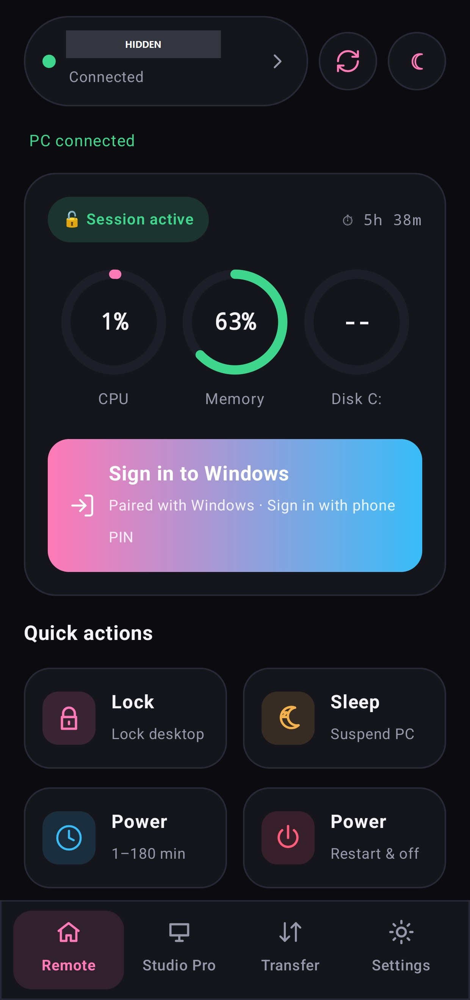
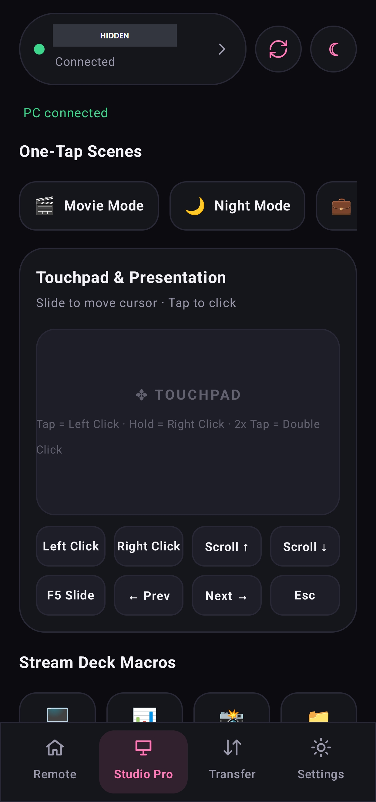
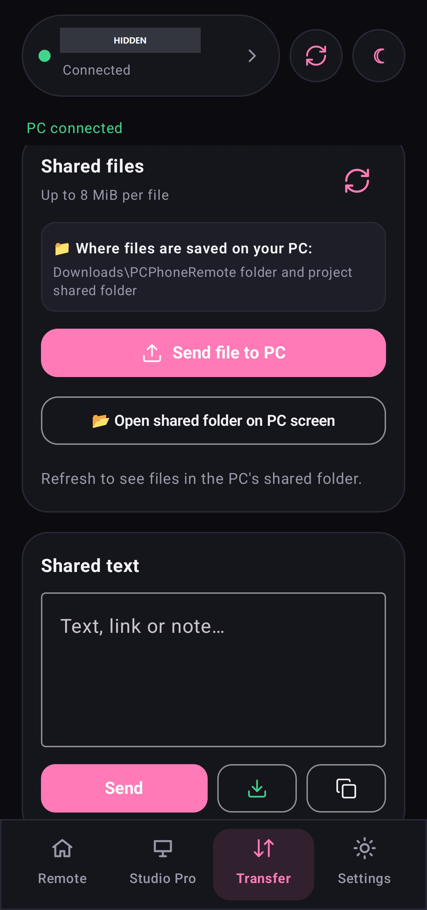
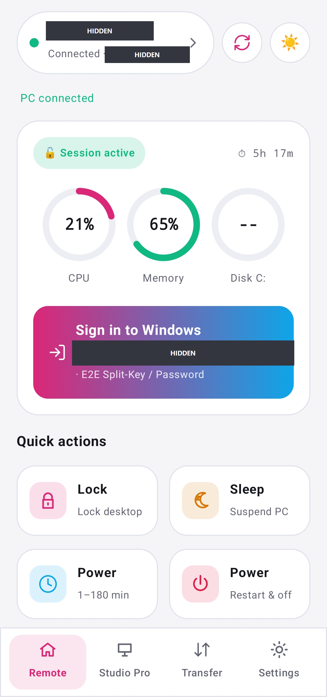
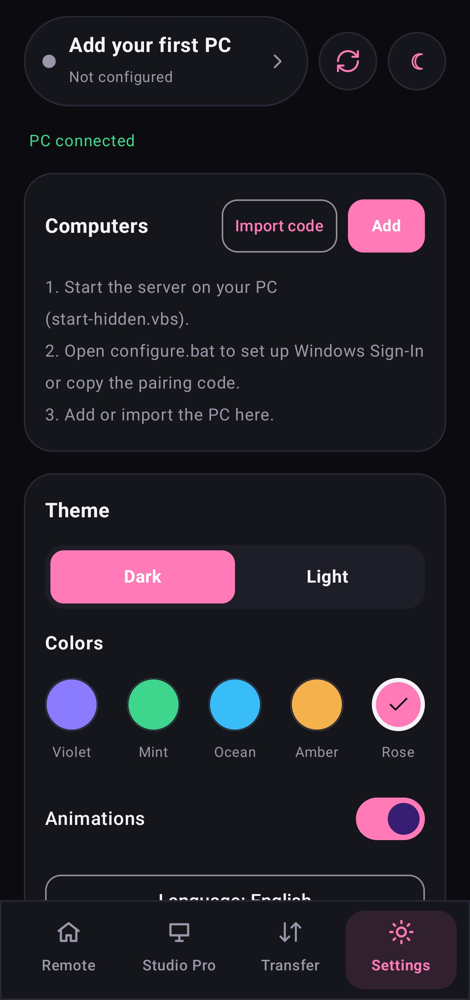
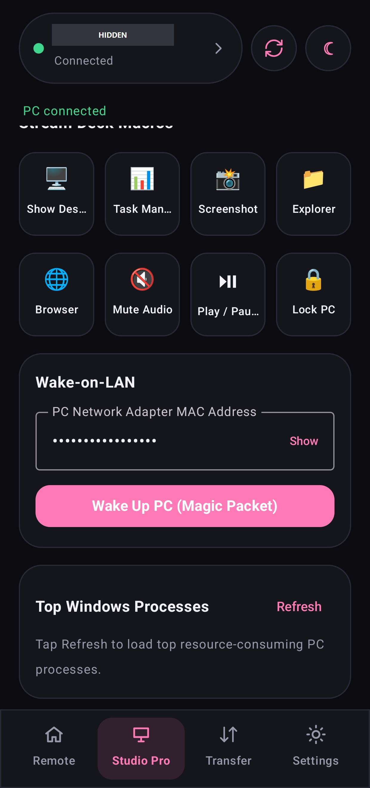

# PC Phone Remote

**Your Windows PC, within reach of your Android phone.**

A native Kotlin + Jetpack Compose remote for everyday PC control: power, media, touchpad, file transfer and device management. Connect directly on a reachable network or use your own HTTPS relay.

[Download 2.2](https://github.com/kznkutsubyo/remote-pc-control/releases/tag/v2.2.0) · [Relay package](https://github.com/kznkutsubyo/remote-pc-control/pkgs/container/remote-pc-control-relay) · [Security](SECURITY.md) · [MIT License](LICENSE)

## Preview

<p>
  
  
  
</p>

Captured on a physical Android phone. Personal fields have been covered with opaque masks and the phone status bar removed; the remaining interface is unchanged. Screenshots illustrate the UI, not proof of a successful Windows unlock. See the [screenshot notes](docs/SCREENSHOTS.md).

<details>
<summary>Light theme, appearance settings and Wake-on-LAN</summary>
<p>
  
  
  
</p>
</details>

## What You Can Do

| Area | Features |
| --- | --- |
| Remote | Lock, sleep, restart, shutdown, media playback, mute and volume |
| PC status | CPU, memory, uptime and session status |
| Studio | Touchpad, scenes, action deck, process list and Wake-on-LAN helper |
| Transfer | Send and receive files; exchange text and links |
| Devices | Save multiple computer profiles and import setup codes |
| Appearance | Light/dark mode, color palettes, animations and language selection |
| Remote access | Optional self-hosted relay for commands and shared data |
| Windows sign-in | Optional native credential provider and service with encrypted phone enrollment |

Use the project only on computers you own or are authorized to administer.

## Downloads

Get the files from [Releases](https://github.com/kznkutsubyo/remote-pc-control/releases/latest):

| File | Contents |
| --- | --- |
| `PCPhoneRemote-v2.2.apk` | Android app for manual installation |
| `PCPhoneRemote-Windows-v2.2.zip` | Python server, setup tools and optional Windows x64 sign-in components |
| `PCPhoneRemote-Relay-v2.2.zip` | Relay source distribution |
| `SHA256SUMS.txt` | SHA-256 checksums for the downloads |

The APK uses a development signing key. It is not a Play Store production build. The Windows archive requires Python and installation of its dependencies.

## Get Connected

### On Your PC

1. Extract the Windows archive.
2. Open `pc-phone-remote` and run `install-deps.bat`.
3. Start the server with `run.bat`.
4. Open `configure.bat` to configure the connection and obtain the phone setup code.

For a manual start:

```powershell
cd pc-phone-remote
python -m pip install -r requirements.txt
$env:REMOTE_PIN = "<your-own-pin>"
python app.py
```

Without a PIN override, first launch generates a random PIN in local `config.json`. A pre-existing empty config PIN must be filled before use. Real connection details and credentials are not bundled with the source.

### On Your Phone

1. Install the APK from Releases.
2. Add a computer in Settings/devices, or import the setup code from the PC.
3. Select the device, then refresh the remote to verify the connection.
4. Open Studio or Transfer for the other controls.

For direct mode, the phone must be able to reach the PC address. `127.0.0.1` on the phone points to the phone itself, not your computer.

## Files And Shared Text

Transfers are limited to **8 MiB per file**. The server shares a dedicated folder rather than exposing the whole filesystem; uploads do not overwrite existing files. The shared text board supports up to **64 KiB**.

Use the Transfer screen for phone uploads/downloads. The PC also has an authenticated transfer page at `http://127.0.0.1:8765/share`. The application does not automatically execute received files or continuously monitor either clipboard.

## Outside Your Home Network

The optional relay lets the PC maintain an outgoing connection to your server:

```text
Android app → HTTPS relay → PC agent → Windows PC
```

Use a trusted relay host, HTTPS, a unique `RELAY_PIN` and a random `RELAY_AGENT_TOKEN` of at least 24 characters. Each relay instance serves one PC. Update the relay and PC agent together.

The relay container is published in [GitHub Packages](https://github.com/kznkutsubyo/remote-pc-control/pkgs/container/remote-pc-control-relay):

```text
ghcr.io/kznkutsubyo/remote-pc-control-relay:2.2.0
```

Pass credentials as environment variables at deployment, not as values committed to the repository. Standard file/text transfers use transport encryption through HTTPS, not end-to-end encryption against the relay.

See [relay setup](pc-phone-remote/README_REMOTE.md) for deployment details.

## Windows Sign-In

Version 2.2 includes an **optional native Windows credential provider and service**. Phone enrollment and unlock requests use an encrypted, signed protocol. This is separate from the optional external RDP-client connection.

**Validation status:** the native components build and pass automated self-tests. Actual Windows lock-screen sign-in has not been verified in a disposable Windows VM. Validate with a recoverable test environment before registering the credential provider on a primary PC. Automated tests are not a guarantee of successful desktop unlock.

Read the [native component documentation](windows-unlock/README.md) and included install/uninstall scripts before enabling it.

## Autostart And Background Operation

The Windows server can start after user logon using Task Scheduler and `start-hidden.vbs`. This is logon startup, not a guarantee of availability before the first Windows sign-in after reboot.

The optional tray launcher provides server controls and access to configuration and shared data. Optional scheduled command tasks support power actions while the session is locked. Media and touchpad actions require an interactive unlocked session.

## Build And Verify

```powershell
# Server tests
cd pc-phone-remote
python -m unittest discover -s tests -v

# Android release
cd ..\pc-phone-remote-android
.\gradlew.bat assembleRelease

# Native Windows components (MSVC + Windows SDK required)
cd ..
powershell -NoProfile -ExecutionPolicy Bypass -File windows-unlock\build.ps1 -RunTests
```

Android release output: `pc-phone-remote-android/app/build/outputs/apk/release/app-release.apk`.

Release 2.2 was built with 17 passing server tests and 10 passing native self-tests. These checks do not replace physical-device and Windows sign-in testing.

## Project Layout

| Directory | Purpose |
| --- | --- |
| `pc-phone-remote/` | Python server, relay, PC agent and desktop setup |
| `pc-phone-remote-android/` | Native Kotlin/Compose Android app |
| `windows-unlock/` | Optional native Windows provider and service |
| `docs/` | Screenshots and contribution guides |
| `tools/` | Build, packaging and development helpers |

Local configs, secrets, logs and generated binaries are excluded from source control. Release binaries are distributed through Releases; the relay container is distributed through Packages.

## License

MIT. See [LICENSE](LICENSE). Included Lucide icons retain their [license notice](pc-phone-remote-android/LUCIDE-LICENSE.txt).
